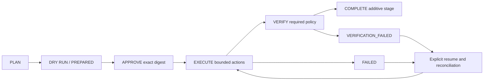

# PartitionGuard

**Safely plan, execute, recover, and verify changes to production data products.**

PartitionGuard is a Python CLI for engineers changing existing datasets. It turns
an ODCS contract change and a bounded migration recipe into a reviewable plan,
requires approval of that exact plan, records each committed partition, and
verifies the result before marking the stage complete.

**0.1.0 is an early, locally tested release candidate.** The repository includes
installable distributions and publishing workflows; no public PyPI or GitHub
release is claimed. The original working name was DataGuard; see the
[name availability review](docs/name-review.md).

## What you can do today

- Compare an ODCS relational subset, explain compatibility and deterministic risk,
  and inspect explicitly declared or imported downstream impact.
- Add a replacement column and copy or strictly convert selected DATE partitions.
  Preserve the original representation while preparing consumer migration.
- Enforce date, partition-count and row limits; bind a successful dry-run and exact
  plan approval to a destination, source fingerprint and runtime versions.
- Recover from a failed action or a crash between a target commit and its local
  checkpoint. Reconcile completed work and replay deterministic assignments.
- Require source stability, schema, row counts, keys, conversion parity, partition
  completeness and every declared verification check before `COMPLETE`.
- Inspect an append-only, hash-linked SQLite audit trail, including failed attempts.

The initial execution model requires a maintenance window with writers frozen.
It completes a **bounded additive stage**, not a whole-table migration, online
producer cutover, consumer deployment, or destructive field retirement. Those
operations are blocked. A nullable replacement outside the selected date range
can remain unpopulated; the scope is recorded in the plan and evidence.

## Try a real migration locally

Python 3.11+ on Linux or macOS:

```sh
python -m pip install '.[duckdb]'
partitionguard init tutorial-contracts
python examples/create_demo.py tutorial.duckdb

partitionguard plan tutorial-contracts/current.yaml tutorial-contracts/proposed.yaml \
  --migration tutorial-contracts/migration.yaml --output plan.json

# Default is a data read-only dry-run; evidence is persisted locally.
partitionguard migrate plan.json --connection tutorial.duckdb --ledger tutorial-ledger.sqlite

PLAN_DIGEST="$(python -c 'import json; print(json.load(open("plan.json"))["plan_id"])')"
partitionguard approve plan.json --connection tutorial.duckdb --ledger tutorial-ledger.sqlite \
  --digest "$PLAN_DIGEST" --operator local-engineer

partitionguard migrate plan.json --connection tutorial.duckdb --ledger tutorial-ledger.sqlite \
  --execute --maintenance-window --operator local-engineer

partitionguard verify plan.json --connection tutorial.duckdb --ledger tutorial-ledger.sqlite
partitionguard history --ledger tutorial-ledger.sqlite
```

The example creates eight synthetic rows. Six are in the three selected daily
partitions; two remain outside the migration. The plan is generated from files
and the engine operates on a real DuckDB table. There is no hardcoded plan output.
`examples/create_demo.py` refuses to overwrite an existing database.

For database credentials, set `PARTITIONGUARD_CONNECTION` and omit `--connection`.
Plans and ledgers do not store the connection string. Use `--json` for machine
output. Run `partitionguard --help` or a command's `--help` for options.

## Execution lifecycle



To resume after investigating a failure, repeat the execution command with
`--resume`. Keep the same plan, target and ledger. The baseline cannot be replaced
silently. Successful earlier partitions remain committed; this is at-least-once
replay of idempotent assignments, not cross-system exactly-once execution or
automatic rollback. See [recovery tutorial](docs/tutorials/04-recovery.md).

## Adapter support

| Adapter | Implemented scope | Validation in this checkout |
| --- | --- | --- |
| Local files | Read ODCS relational subset, immutable JSON plans, SQLite ledger | Parser, safety, CLI, integrity tests |
| DuckDB | Plain tables; transactional additive columns and bounded copy/cast | Real DuckDB tables and crash/recovery tests |
| PostgreSQL | Plain tables; transaction per action, advisory locks and restricted verification | Real local PostgreSQL 14.20; no native partition trees, triggers, RLS, views or rewrite rules |
| Delta Lake | Local filesystem tables physically partitioned by one DATE; metadata additions, atomic per-action updates, history/snapshots | Real delta-rs tables, version conflict, file-boundary, recovery and historical verification tests |
| AWS planning inputs | Capped S3 prefix inventory and Glue external-table schema inspection | Botocore request/response stubs; no live AWS validation or AWS execution |
| OpenLineage | Offline completed-run event import with provenance and explicit identity mapping | Deterministic parser/graph tests; no live catalog integration |

Install optional dependencies with `.[postgres]`, `.[delta]`, or `.[aws]`.
Vendor SDKs are imported only when their adapter is selected. New contract,
storage and lineage plugins load through versioned entry points; catalog, query,
execution and verification roles have extension interfaces, not a distributed
runtime. See [plugin development](plugin-development.md).

## Verification and limits

Built-in policies include uniqueness, null rates and comparisons, inclusive
numeric ranges, enumerations, aggregate parity with absolute/relative tolerance,
freshness, and restricted scalar SQL assertions over the selected scope. Unknown
required contract semantics block execution. `COMPLETE` is not possible merely
because a SQL update succeeded. [Verification reference](docs/verification-reference.md)

Date predicates and row caps bound the logical workload and fetched data, not
physical bytes scanned. SQL engines may scan a larger table without suitable
layout/indexes. Delta updates can rewrite files in selected partitions. Exact
source fingerprints consume memory proportional to bounded rows and are not a
large-scale streaming verifier. [Measured benchmark](benchmarks/README.md)

Operator names are supplied assertions, not authenticated approvals. Local hash
chains detect accidental edits; a privileged administrator can rewrite a ledger
and its hashes. Source writers must remain frozen. Local file/advisory locks do
not establish a distributed fence against arbitrary external writers. See
[security model](SECURITY.md) and the adapter-specific guides
([SQL](docs/sql-adapters.md), [Delta](docs/delta.md), [AWS](docs/aws.md)).

## Pull-request checks

```sh
partitionguard plan current.yaml proposed.yaml --migration migration.yaml \
  --ci --json --summary summary.md
```

Exit codes: `0` success, `2` invalid input, `3` CI/contract policy blocked,
`4` execution/infrastructure failure, `5` failed verification, `6` unmet safety
precondition or approval. Analysis commands require no database credentials.
A generated Markdown summary can be appended to `$GITHUB_STEP_SUMMARY`; the CLI
never posts to a pull request automatically.

## Tutorials with executed output

1. [Safely rename a column](docs/tutorials/01-rename.md)
2. [Perform an incompatible type migration](docs/tutorials/02-type-migration.md)
3. [Backfill historical partitions](docs/tutorials/03-backfill.md)
4. [Recover from a failed migration](docs/tutorials/04-recovery.md)
5. [Verify a completed migration](docs/tutorials/05-verification.md)
6. [Analyze downstream blast radius](docs/tutorials/06-blast-radius.md)
7. [Run checks in GitHub Actions](docs/tutorials/07-github-actions.md)

Regenerate all seven with `python examples/run_tutorials.py`. Transcripts are
recorded from execution; JSON excerpts are labelled. The GitHub Actions YAML is
provided and locally linted, not claimed to have run on a remote repository.

## Contribute and evaluate

```sh
python -m pip install -e '.[duckdb,postgres,delta,aws,dev]'
pytest
ruff check .
ruff format --check .
python -m build
mkdocs build --strict
```

Set `PARTITIONGUARD_TEST_POSTGRES` to a disposable test database to run the real
PostgreSQL tests. Without it those tests explicitly skip. CI provisions a
PostgreSQL service. Property tests cover meaningful diff, graph, partition,
fingerprint and idempotency invariants. [Validation record](docs/validation.md)

Start with [architecture](docs/architecture.md), [contributing](CONTRIBUTING.md),
[phase review](docs/phase-review.md) and [roadmap](docs/roadmap.md). The
[competitive review](docs/competitive-landscape.md) acknowledges that SQLMesh,
orchestrators, migration systems and quality frameworks already solve adjacent
problems. This tool focuses on reviewed migration procedures for datasets owned
outside a transformation framework. It includes no AI safety decisions, custom
Rust component, scheduler, generic catalog, or vendor lock-in.

Licensed under Apache-2.0. Real-user validation and a public release remain next
steps; passing local tests is not evidence of production-scale maturity.
