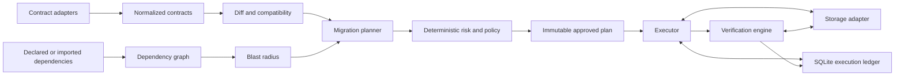

# Architecture

PartitionGuard is a Python control plane for reviewable, recoverable data-product migrations. Its orchestration boundary is one approved plan. It delegates physical operations to adapters and keeps the durable execution evidence in a separate ledger.

This is the design contract. The README and release notes identify the implemented subset.

## Components and data flow

The planner returns structured data. CLI rendering never contains independent compatibility or risk decisions. Both JSON and text derive from the same objects. No vendor SDK belongs in the diff, graph, policy, or state-machine modules.

## Core objects

- **Contract:** normalized identity, version, fields, keys, partition policy, dependencies, checks, SLA, retention, compatibility policy, and retained source metadata.
- **Change:** stable path, old/new values, change kind, compatibility classification, rule identifier, and evidence or reason.
- **Impact:** direct and transitive products/consumers, models, quality policies, SLAs, and lineage completeness.
- **Plan:** input contract fingerprints, rule/plan format versions, adapter and logical table identity, operations, partition bounds, execution limits, preconditions, verification requirements, manual requirements, and digest.
- **Action:** typed operation with stable ID, dependencies, safety classification, retry semantics, and executable/manual capability.
- **Run:** plan digest, operator, lifecycle state, attempts, timing, checkpoint references, failure/recovery information, and verification outcome.
- **Verification result:** check identity, required status, observed/expected values, threshold, pass/fail/error, scope, and evidence timestamps.

Canonical serialization excludes volatile values such as plan creation time from the digest. Any semantic change to a bound, logical table, operation, check, or threshold requires a new digest and approval. The connection-resolved physical database identity is bound later, when dry-run creates the prepared ledger record. Approval applies to that prepared record as well as the plan digest; apply checks the same physical identity. Credentials are never part of either identity. Deserializers validate content rather than trusting a stored digest.

## Safety boundaries

1. Loading, validation, comparison, impact, and planning are read-only.
2. Execution requires supported capabilities, a successful dry-run/preflight, exact digest approval, explicit bounds, and the required writer-freeze acknowledgement.
3. Physical table inspection checks the plan's assumptions. Contract files alone do not authorize arbitrary operations against a different table.
4. The initial rename/type path adds a shadow column, applies a fixed copy or cast assignment, and verifies parity. It preserves the source column.
5. Verification of the intended projection explicitly permits retained legacy columns; it must not falsely claim the physical table exactly equals the final destructive target schema.
6. Unsupported expressions, destructive actions, online concurrency protocols, and pending consumer work block automatic completion.

## Transaction and recovery model

DuckDB and PostgreSQL execute each supported batch within a database transaction. A batch is small enough to retry and has finite scope. The ledger is SQLite, outside that transaction. A process may therefore commit a target batch and crash before recording its checkpoint.

The executor uses **at-least-once attempts** with deterministic, idempotent assignments. Replaying `shadow = CAST(source AS supported_type)` for the same frozen source and same partition must converge to the same state. It must not replay incrementing, random, time-dependent, external side-effecting, or otherwise non-idempotent transformations. A checkpoint is optimization and evidence, not the only basis for correctness. Each column addition and each operation/partition update is a separate action transaction. This also fits the Delta adapter, where one mutation commits atomically and a later verification exception cannot roll it back.

On resume, the executor verifies the same plan identity, prepared physical target identity, baseline, and preconditions. The baseline includes the core and adapter runtime versions, preventing silent replay after a semantics-changing dependency upgrade. Committed checkpoints are reconciled against target state. Failed or ambiguous work can be retried only under its declared retry contract. A baseline mismatch stops recovery and requires investigation/replanning. The system does not silently adopt new source data as the old approved baseline.

## Source consistency

The operator freezes source writes for the bounded workload. Baselines record adapter-supported evidence sufficient for the migration's checks; row counts alone cannot detect value mutation. Reconciliation checks source stability before using checkpoints and before final completion. The plan documents evidence limitations, including hash collision risk or any adapter restriction. A complete cross-table or cross-system snapshot is not implied.

An adapter that cannot deliver required atomicity or source reconciliation must report that capability as unavailable. Delta Lake transaction semantics and concurrency checks are adapter-specific; relational assumptions must not be copied into that adapter.

## Dependencies and deployment

The package supplies a local CLI and importable library. SQLite ledger storage is appropriate for one local controller; multi-controller scheduling, shared ledger services, remote workers, and distributed leases are future architecture work. Local single-writer locking protects a plan from concurrent execution through this controller. It cannot lock unrelated external applications.

Optional dependency groups carry DuckDB, PostgreSQL, Delta Lake, and development requirements. Python entry points load contract, storage, lineage, execution, and verification plugins. Catalog and query-engine roles can expose the narrower storage/lineage interfaces instead of creating parallel vendor abstractions.

## Complexity review criteria

Add an abstraction when two real integrations require it or when a safety boundary needs it. Avoid a generic workflow language, arbitrary expression DSL, event bus, distributed scheduler, or premature Rust extension. Prefer small typed operations with testable semantics over a broad adapter that returns success for unsupported work.
