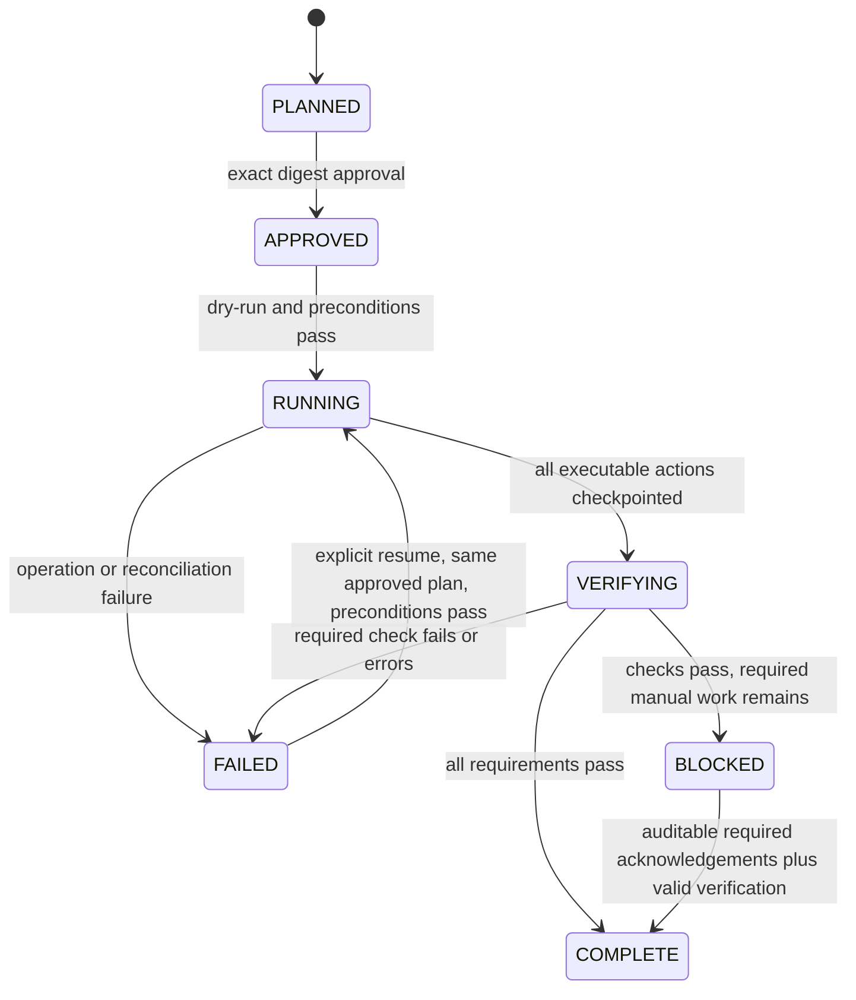

# Migration model

A migration is an approved, content-addressed plan plus a sequence of durable execution attempts and verification results. It is not an arbitrary SQL script or a promise that every planned step is automated.

## Plan content

The plan carries a plan format version; product and source/target contract versions and fingerprints; adapter and logical table identity; normalized changes; compatibility/risk reasons; dependency impact; typed actions with dependencies; workload bounds and limits; source-consistency preconditions; required checks; and explicit manual requirements. Its digest binds all semantic content, including thresholds and logical table identity. Dry-run separately binds the resolved physical database identity and immutable source/runtime baseline in the prepared ledger record; execution verifies that binding. The core/driver version signature is recorded with that baseline.

Action IDs remain stable across serialization. Each action declares whether it is executable, requires manual acknowledgement, is destructive, and is retryable. Dynamic SQL is generated only from validated typed operations and safely quoted identifiers. The first executor accepts a fixed copy/cast expression set; it does not run arbitrary migration SQL supplied through a contract.

## Additive rename/type migration

1. Inspect the physical schema and capture approved-scope source evidence.
2. Confirm writer freeze and plan identity.
3. Add a replacement column using a supported target type.
4. Populate bounded historical partitions with deterministic copy/cast assignments.
5. Check conversion validity, source stability, row/key invariants, and source-to-target parity.
6. Record downstream migration and writer cutover requirements as manual actions.
7. Complete the explicitly additive staged target when all its requirements pass. If the proposed target also requires consumer cutover or destructive retirement, block completion while that unsupported/manual work remains.
8. Retain the original column. A future destructive retirement requires a separate reviewed plan.

The plan may describe an online dual-write strategy as a manual prerequisite, but the initial executor requires frozen writers and does not install streaming transforms. A failed cast aborts its transactional batch. The executor must not substitute nulls and call the migration successful.

Adding a column can survive a failed backfill; that is an explicit partial state. Recovery repopulates deterministic assignments. A preexisting replacement column must have a compatible physical definition and known ownership/state before the executor uses it; it must not overwrite unrelated data silently.

## Lifecycle

These are conceptual states; the implementation may store additional attempt-level states. A release without a safe acknowledgement mechanism leaves manually gated migrations blocked. A check result is PASS, FAIL, or ERROR; an error cannot count as pass. Approval never moves a failed verification directly to complete.

## Ledger and audit

Persist migration/run IDs, plan digest and snapshot, physical target, product versions, operator identity, approval, start/finish timestamps, state transitions, typed actions, attempt numbers, retries, partition checkpoints, failures, verification results, and recovery guidance. Events include duration and structured error context without credentials.

Record new attempts/events instead of erasing failed history. SQLite durability provides local persistence, not tamper-proof third-party attestation. Exported evidence supports review; external signing/immutable storage is separate work. Operator is a supplied identity, not necessarily authenticated identity.

## Recovery contract

Database commit and SQLite checkpoint are not atomic together. An uncheckpointed batch may already be committed. Resume reconciles source and target and safely repeats supported assignments. This is at-least-once execution, not exactly once. Checkpoint presence does not waive final verification.

The same migration cannot resume under a modified plan, changed target, changed adapter semantics, or adopted new baseline. Baseline drift requires intervention and a new plan when necessary. No automatic rollback claim is made: successful additive writes can remain after failure, and external consumer changes are not reverted by the tool.
